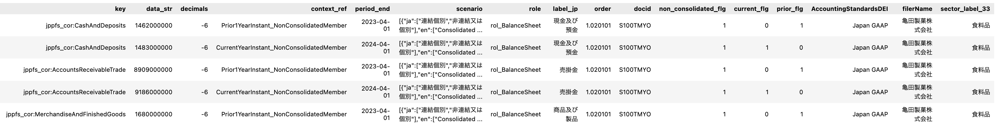

# edinet_xbrl_prep

EDINET の有価証券報告書（XBRL）を取得し、財務数値・テキストを1つの表（大福帳、One Big Table）にまとめる前処理ライブラリです。

このリポジトリについてはブログ「99から始める有価証券報告書XBRL分析」をご覧ください。

[99から始める有価証券報告書XBRL分析](https://norororo.hatenablog.com/entry/2024/12/20/081109)



## 導入

Python 3.12 以上（開発は 3.12。Google Colab の 3.13 でも動作を確認しています）。

```bash
pip install "git+https://github.com/nororo/edinet_xbrl_prep.git"
# 分析例（トピックモデル・ワードクラウドなど）と LLM の補助も使う場合
pip install "edinet-xbrl-prep[analysis,llm] @ git+https://github.com/nororo/edinet_xbrl_prep.git"
```


## 使い方

```python
from pathlib import Path
from edinet_xbrl_prep import (
    TaxonomyCache, add_tse_sector, build_fs_table, documents_frame, download_documents,
    fetch_document_lists, read_tse_sector, save_document_list, select_reports,
)

DATA = Path("data")

# 1. 書類一覧 API で書類一覧を取得する（開始日・終了日を含む）。API キーは引数か環境変数 EDINET_API_KEY
results = fetch_document_lists("2024-06-15", "2024-06-30", api_key=your_api_key)
documents = documents_frame(results)                                   # 1行＝1書類（DocumentListDf）
yuho = add_tse_sector(select_reports(documents), read_tse_sector())    # 有価証券報告書＋東証の業種区分
save_document_list(yuho, DATA / "yuho_documents.parquet", source_data_list=["EDINET 書類一覧 API"])

# 2. 書類取得 API で XBRL の ZIP をダウンロードする（{docid}.zip。すでにあれば飛ばす）
download_documents(yuho.docID, DATA / "xbrl_doc", api_key=your_api_key)

# 3. タクソノミのキャッシュ。書類が参照する版を EDINET から取得して置く（2回目以降はキャッシュを読む）
taxonomy = TaxonomyCache(DATA / "taxonomy_cache")

# 4. 大福帳（One Big Table）を作る
result = build_fs_table(
    yuho.docID, DATA / "xbrl_doc", taxonomy,
    statements=["BS", "PL", "report"],     # 財務諸表の種類（下の表）。省略するとすべて
    documents=yuho,                         # 提出者名・業種を各行に付ける
    out_path=DATA / "fs_big_table.parquet", # 保存する場合（リネージ・処理結果も書く）
)
fs_tbl = result.table   # 大福帳（FsBigTableDf）
result.log              # 書類ごとの処理結果（success・empty・failure と理由）
```

書類1件だけを処理する場合は `get_fs_tbl(zip_path, taxonomy)` を使います。

### 財務諸表の種類

ロール名（例：`rol_ConsolidatedBalanceSheet`）に、次の文字列のどれかを含むロールを選びます（`STATEMENT_ROLE_PATTERNS`）。

| 種類 | 内容 | ロール名に含む文字列 |
|------|------|---------------------|
| `BS` | 貸借対照表（IFRS の連結財政状態計算書を含む） | `_BalanceSheet`、`_ConsolidatedBalanceSheet`、`_ConsolidatedStatementOfFinancialPositionIFRS` |
| `PL` | 損益計算書（IFRS を含む） | `_StatementOfIncome`、`_ConsolidatedStatementOfIncome`、`_ConsolidatedStatementOfProfitOrLossIFRS` |
| `CF` | キャッシュ・フロー計算書 | `_StatementOfCashFlows`、`_ConsolidatedStatementOfCashFlows` |
| `SS` | 株主資本等変動計算書 | `_StatementOfChangesInEquity`、`_StatementOfChangesInNetAssets` |
| `CI` | 包括利益計算書 | `_ConsolidatedStatementOfComprehensiveIncome` |
| `report` | 有価証券報告書の本文（テキストブロック） | `_CabinetOfficeOrdinanceOnDisclosure` |
| `notes` | 注記 | `_Notes` |

連結のロール（ロール名に `Consolidated` を含む）には連結の値だけ、個別のロールには個別の値だけを残します（`report` はすべて残す）。

### 大福帳の列（主なもの。全体は `schemas.FsTblDf`）

1行＝1書類×1ロール×1科目×1 context の Fact。主キーは（`docid`, `role`, `key`, `context_ref`）。

| 列 | 内容 |
|----|------|
| `docid`・`statement`・`role` | 書類管理番号・財務諸表の種類・ロール |
| `key`・`element_name` | 科目（`jppfs_cor:NetSales` のように 接頭辞:要素名）・要素名 |
| `context_ref`・`dimensions` | コンテキスト・次元とメンバー（JSON。セグメントなど） |
| `data_str`・`decimals`・`unit` | 値（文字列）・表示単位（-3：千円、-6：百万円）・単位 |
| `period_type`・`period_start`・`period_end`・`instant_date` | 期間の種類（duration・instant）・期首日・期末日・時点（XBRL に書かれた日付） |
| `label_jp`・`label_jp_long`・`label_en`・`label_en_long`・`label_source` | ラベル（企業別のラベルを優先し、なければ共通タクソノミ）とその取得元 |
| `order`・`order_path`・`layer`・`parent_key_list`・`preferred_label` | presentation の表示順・親からの並び・深さ・親科目・ラベルの種類 |
| `non_consolidated_flg`・`current_flg`・`prior_flg` | context が個別・当期・前期 |
| `calculated_flg`・`net_flg`・`net_src_flg`・`calc_parent_key`・`calc_weight` | calculation の計算関係 |
| `debit_flg`・`credit_flg`・`balance` | 借方・貸方（計算関係から）、科目定義の貸借区分 |
| `accounting_standards` | 会計基準（Japan GAAP・IFRS・US GAAP） |

数値の分析には `preproc_num`（`data_str` を数値の `data` に）、`pick_base_context`（セグメント別などを除き基本の値を残す）、`fill_df`（書類×科目の欠けを補う）を使います。

## 出力とデータリネージ

このライブラリが保存する表（`save_document_list`・`build_fs_table`・`save_table`）には、同じ場所に
`{出力ファイル名}_lin.json` を書きます。

| 項目 | 内容 |
|------|------|
| `file_name` | ファイル名（フルパス） |
| `purpose` | 目的 |
| `source_code` | 作成したコード（`edinet_xbrl_prep/fs_tbl.py::build_fs_table` など） |
| `date_of_source_code` | そのコードの最終更新日 |
| `source_data_list` | 元データ（書類の ZIP のように大量にあるものは件数と場所だけ） |
| `record_num`・`schema`・`record_example` | 行数・列名・1行目 |
| `data_structure`・`importance_columns` | データ構造の説明・重要な列 |
| （追加）`sha256`・`created_at`・`package_version`・`config` | 出力のハッシュ・作成日時・パッケージの版・実行時の設定 |

保存の前に pandera のスキーマ（`edinet_xbrl_prep/schemas.py`）で検証します。

## タクソノミ

`TaxonomyCache(cache_dir)` は Arelle のキャッシュとして使うディレクトリです。共通タクソノミのラベルも同じ場所から、書類が参照する版の日付で読みます。

- 既定では、キャッシュにないファイルを Arelle が EDINET（disclosure.edinet-fsa.go.jp）などから取得します（1版あたり約20MB）
- `TaxonomyCache(cache_dir, offline=True)` はネットワークに出ずキャッシュだけを読みます。金融庁が公開する zip から作る場合は `download_fsa_taxonomy("2024", dir)` と `seed_from_taxonomy_zip(zip_path, cache)` を使います

## 構成

```text
edinet_xbrl_prep/
├── edinet_api.py   EDINET API（書類一覧・書類取得）、書類一覧の表、業種区分
├── taxonomy.py     タクソノミのキャッシュ・Arelle・共通ラベルと企業別ラベルの決定
├── archive.py      ZIP から有価証券報告書本体（PublicDoc の asr）のファイルを取り出す
├── linkbase.py     presentation・calculation・label の linkbase とスキーマの解析
├── facts.py        Arelle で Fact（値・期間・次元）を取り出す
├── fs_tbl.py       書類ごとの fs_tbl と大福帳の組み立て
├── numeric.py      数値の前処理（preproc_num・fill_df）
├── text.py         テキストの前処理（preproc_nlp）
├── llm.py          LLM による抽出の補助（Prompt・GroqAPI。追加の依存 llm）
├── schemas.py      pandera のスキーマ
└── lineage.py      表の保存とリネージ
examples/           分析例（v0.2 の API）
scripts/            依存関係グラフ・テスト一覧の HTML の生成
tests/              テスト（tests/colab/ は Colab での確認用スクリプト）
```

## テストと HTML
uvを利用しtestの実行ができます。

```bash
git clone https://github.com/nororo/edinet_xbrl_prep.git
cd edinet_xbrl_prep
uv sync
uv run pytest                                          # 実際の書類を使うテストは飛ばす
EDINET_FIXTURE_DIR=/path/to/zips uv run pytest         # 書類の ZIP（{docid}.zip）を使うテストも実行する
uv run python scripts/build_tests_report.py            # テストを実行して ../docs/tests_report.html を作る
uv run python scripts/build_dependency_graph.py        # ../docs/dependency_graph.html と ../docs/graph_metrics.json
```
